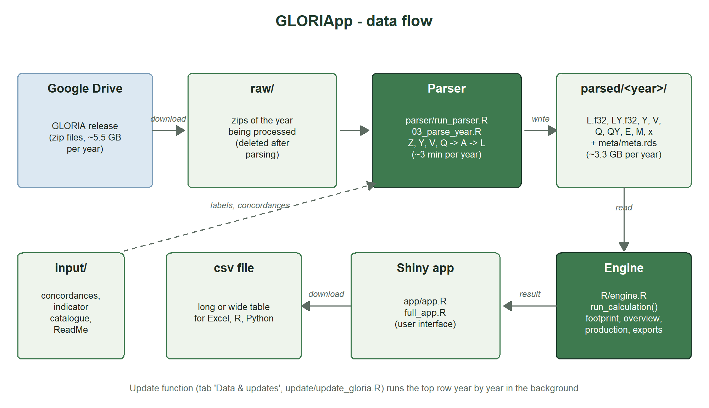
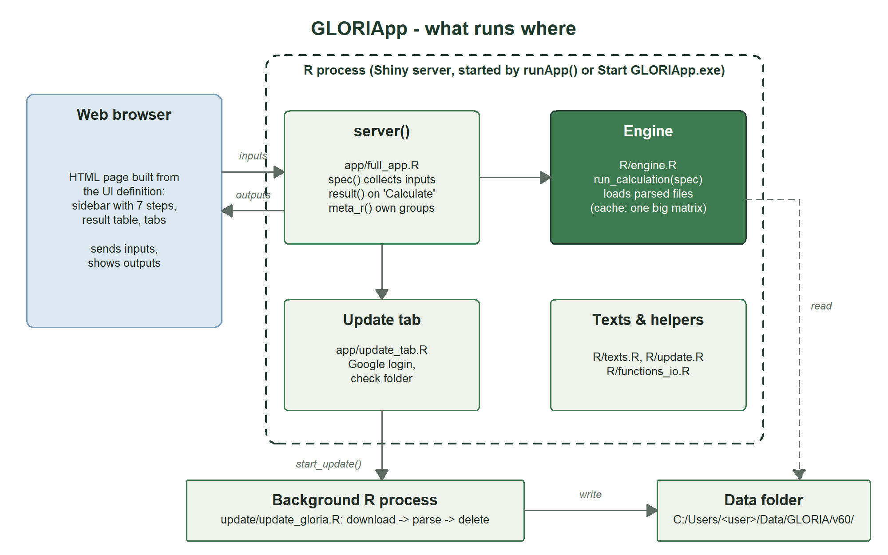

# Overview

GLORIApp has three layers that can be used independently:

1. **Parser** (`parser/`): turns a raw GLORIA release (zip files from Google Drive) into analysis-ready binary/RDS files, one folder per year.
2. **Engine** (`R/engine.R`): all footprint calculations on the parsed data. Pure R functions, no Shiny, usable from any script.
3. **App** (`app/`): Shiny user interface on top of the engine, plus the update function (`R/update.R`, `update/update_gloria.R`).

Dependencies: R >= 4.3 with `data.table`, `Matrix`, `arrow`, `openxlsx`, `jsonlite` (parser/engine), `shiny`, `bslib`, `DT`, `markdown`, `plotly` (app), `googledrive` (updates), `officer`, `mschart` (slides only), `testthat` (tests). The parser uses the `tar.exe` that ships with Windows 10+ to read zip files larger than 4 GB.

# Architecture at a glance

This chapter explains how the pieces fit together. It assumes R knowledge but **no Shiny knowledge**.

## Data flow: from Google Drive to the csv file

{width=100%}

The work is split into two phases that are completely separate:

1. **Preparation (once per GLORIA release, hours).** The parser reads the huge raw tables, computes the Leontief inverse $L$ and other matrices, and writes them to the data folder (`parsed/<year>/`). After that the raw data are deleted. This is the slow, memory-hungry part (~3 minutes and ~15 GB RAM per year).
2. **Analysis (every time a user clicks Calculate, seconds).** The engine only *reads* the prepared files and does comparatively cheap matrix products and aggregations. It never touches the raw data.

Because of this split, the engine can also be used without the app, from any R script (see *The engine*), and other tools (Python, Excel via csv) can work on the parsed files.

The small, human-editable files that define *labels and groupings* live in the repository folder `input/` (concordances, indicator catalogue, GLORIA ReadMe). They are used by the parser (labels) and read again by the app at start-up, so a new grouping column added there appears in the app without re-parsing.

## What runs where

{width=100%}

- The **web browser** only displays the user interface. It holds no data and does no calculation.
- One **R process** runs the Shiny server. It is started with `shiny::runApp("app")` in RStudio or by `Start GLORIApp.exe` in the portable version. All calculations happen here, in `R/engine.R`.
- Downloading and compiling a new GLORIA release runs in a **second, separate R process** (`update/update_gloria.R`). That way it can take hours without blocking the app, and it keeps running if the app is closed. The two processes only communicate through files: the data folder, and a log file that the app displays.

## Shiny in five minutes

Shiny is an R package that turns R code into a web application. A Shiny app consists of two parts:

- **`ui`** (user interface): an R object that describes the web page, e.g. `selectInput("years", ...)` creates a drop-down whose current value is available in R as `input$years`, and `DT::DTOutput("table")` reserves space for a table called `table`. In GLORIApp the UI is defined in `app/full_app.R` (sidebar with the 7 steps, result tab, explanation tabs) and `app/update_tab.R` (tab *Data & updates*).
- **`server`**: an R function `function(input, output, session)` that runs once for every browser window. It reads `input$...` values and fills outputs, e.g. `output$table <- DT::renderDT({ ... })`.

The glue between the two is **reactivity**: Shiny remembers which inputs an expression uses and re-runs it automatically when one of them changes. GLORIApp uses three kinds of reactive building blocks:

| Building block | Example in `app/full_app.R` | Behaviour |
|---|---|---|
| `reactive()` | `spec()` | collects all sidebar inputs into one list; recomputed whenever an input changes |
| `eventReactive()` | `result()` | runs `run_calculation(spec())` **only** when the *Calculate* button is clicked |
| `render...()` | `output$table`, `output$description` | produce what the browser shows; re-run when their inputs change |

## What happens when the user clicks *Calculate*

1. The browser sends the button click to the R process (`input$go` changes).
2. `result()` reads `spec()`: a plain R list such as `list(type = "footprint", indicators = "ghg_edgar", years = 2019, production_region = "world_region_7", ...)`.
3. `result()` calls `run_calculation(spec, meta)` from `R/engine.R`. The engine loops over years and indicators, loads the needed files of each year from the data folder (with a small cache), calculates, aggregates with the chosen groupings and returns a long `data.table`.
4. `result_formatted()` optionally reshapes it to wide format (`to_wide()`).
5. `output$status`, `output$table` and `output$download_ui` re-run automatically. The browser shows the preview and the download button. *Download csv* writes the full table with `data.table::fwrite()`.

The engine does not know about Shiny. Anything you can click in the app can be done in a script with the same specification list. This is the main design rule of the code: **user interface in `app/`, calculations in `R/engine.R`, texts in `R/texts.R`**.

## Where to change what

| I want to ... | File |
|---|---|
| change a label or help text in the app | `R/texts.R` (result types, help texts) or `nice_name()` in `app/full_app.R` |
| add a recommended indicator | `input/indicator_catalogue.csv` |
| add a region or sector grouping | new column in `input/concordances/regions.csv` / `sectors.csv` |
| change or add a calculation | `R/engine.R` (and a test in `tests/testthat/test-engine.R`) |
| add an input to the sidebar | UI part of `app/full_app.R` plus the field in `spec()` |
| change how raw data are read | `parser/03_parse_year.R` |
| change paths or the data folder | `config.R` or the environment variable `GLORIA_DATA_ROOT` |
| change the download/update | `R/update.R`, `update/update_gloria.R`, `app/update_tab.R` |
| change or add a chart | `app/charts_tab.R` (plotly; uses the result table only, no extra calculation) |

# Repository layout

| Path | Purpose |
|---|---|
| `config.R` | single place for paths, GLORIA version and parser options |
| `R/functions_io.R` | float32 file format, csv reader, aggregation helpers, logging |
| `R/engine.R` | calculation engine (footprints, production, overview, gross exports) |
| `R/texts.R` | all user-facing texts of the app |
| `R/export.R` | writing results as csv, csv for German Excel, xlsx or tab-separated text |
| `R/update.R` | Google Drive helpers, installed versions, background update start |
| `parser/01_build_concordances.R` | builds `input/concordances/regions.csv` and `sectors.csv` |
| `parser/02_build_meta.R` | builds `meta.rds` (labels, index tables, indicator catalogue) |
| `parser/03_parse_year.R` | parses one year |
| `parser/run_parser.R` | parses all available years (resumable), cleans up raw data |
| `update/update_gloria.R` | download + parse a release year by year (background process) |
| `app/app.R`, `app/full_app.R`, `app/update_tab.R`, `app/charts_tab.R` | Shiny app (main UI, update tab, charts tab) |
| `input/` | ReadMe of the GLORIA version, concordances, indicator catalogue |
| `tests/run_tests.R`, `tests/testthat/` | unit tests (testthat) on a synthetic mini GLORIA |
| `docs/` | user/developer guides (Markdown sources, Word output), slides |
| `legacy/` | original GLORIA-MRIO_Parser scripts (v059), not used |

# Configuration

`config.R` is sourced by every entry point. Key settings:

- `data_root`: data folder, default `C:/Users/<user>/Data/GLORIA`, overridable with the environment variable `GLORIA_DATA_ROOT` (e.g. in `~/.Renviron`).
- `gloria_version`: from env `GLORIA_VERSION`, else `<data_root>/active_version.txt`, else 60.
- `paths`: `raw`, `unzip_tmp`, `parsed`, `meta`, `logs` below `<data_root>/v<version>/`; `input` (repo folder, overridable with `GLORIA_INPUT_DIR`).
- `parser_options`: `store_L`, `delete_unzipped`, `skip_existing`, `delete_raw_after_parse`.

# Raw data and parsing

## GLORIA raw files

A release folder (e.g. `060/`) contains part I (`GLORIA_MRIO_Loop060_part_I_MRIOdatabase/GLORIA_MRIOs_60_<year>.zip`, ~5.5 GB per year) and part III (`..._part_III_satelliteaccounts/GLORIA_SatelliteAccounts_060_<year>.zip`). Per year the parser needs five csv files without header (Markup001 = basic prices):

| File | Dimensions | Content |
|---|---|---|
| `T-Results` | 39,360 × 39,360 | multi-regional supply-use table: per region 120 industries followed by 120 products |
| `Y-Results` | 39,360 × 984 | final demand (164 regions × 6 categories) |
| `V-Results` | 984 × 39,360 | value added (164 regions × 6 components) |
| `TQ-Results` | 6,130 × 39,360 | satellite accounts of industries |
| `YQ-Results` | 6,130 × 984 | satellite accounts of final demand |

Region, sector, final demand, value added and satellite labels come from `GLORIA_ReadMe_0<version>.xlsx` (copied to `input/`).

## Method

Same as the original GLORIA-MRIO_Parser:

- $Z$ = use block of $T$ (rows: products, columns: industries), treated as a square 19,680 × 19,680 sector-by-sector matrix (GLORIA supply is near-diagonal).
- $x = Z\mathbf{1} + Y\mathbf{1}$ (output by product; the parser also reports the deviation from the column view $\mathbf{1}'Z + \mathbf{1}'V$).
- $A = Z\,\mathrm{diag}(x)^{-1}$ with zero output giving zero coefficients.
- $L = (I - A)^{-1}$ via `solve()` (about 2 minutes on a desktop PC; memory peak ~15 GB).

## Parsed files (`<data_root>/v<version>/parsed/<year>/`)

| File | Content | Format |
|---|---|---|
| `Z.arrow` or `Z.rds` | inter-industry flows | float32 Arrow file if dense (>30% non-zeros), else sparse `dgCMatrix`; read with `read_Z(year)` |
| `Y.rds` | final demand 19,680 × 984 | dense matrix |
| `V.rds` | value added 6 × 19,680 | dense matrix, row names = components |
| `x.rds` | gross output | vector |
| `Q.rds`, `QY.rds` | all satellite rows (industries / final demand) | sparse `dgCMatrix` |
| `L.arrow` | Leontief inverse | float32 Arrow file; read with `read_matrix()` (~1 s) |
| `checks.csv` | balance checks, e.g. `output_reproduced_by_L` (must be 1) | csv |
| `_DONE` | marker: year complete | empty file |

`meta/meta.rds` holds a list with `regions`, `sectors`, `fd`, `va`, `satellites`, `idx_Z` (region/sector code of each of the 19,680 rows), `idx_Y` (region/category of each of the 984 final demand columns), `catalogue` (indicator presets with the satellite rows they sum) and `raw_index`.

Only these **standard matrices** are stored; no products of $L$ (such as $L\,Y$ or multipliers) are saved. All footprints are calculated by the engine when they are requested.

**float32 Arrow format** (`write_matrix` / `read_matrix` in `R/functions_io.R`): an Apache Arrow IPC file with one float32 column `v` holding the matrix column by column; `nrow` and `ncol` are stored in the file metadata. Arrow converts float32 to R doubles in fast C++ code (~1 s for $L$, versus ~12 s with base R `readBin`). In Python: `t = pyarrow.ipc.open_file(f).read_all(); L = t["v"].to_numpy().reshape((-1, int(t.schema.metadata[b"nrow"]))).T`. Data parsed with an older version (`*.f32` files) are converted with `parser/convert_parsed_to_arrow.R`.

A parsed year needs ~3.2 GB; 1990-2029 ~125 GB.

## Running the parser

```r
source("parser/run_parser.R")
```

It copies the ReadMe to `input/`, rebuilds the concordances if the number of regions changed, builds `meta.rds`, detects the years present in the raw zips, and parses every year without a `_DONE` marker. For each year it extracts only the five needed csv files into `tmp_unzip/<year>`, deletes them afterwards, and deletes that year's raw zips if the checks pass. When all years are done, the raw folder is deleted (ReadMe and release notes are kept in `parsed/meta`).

# The engine

```r
source("config.R"); source("R/functions_io.R"); source("R/engine.R")
meta <- readRDS(file.path(paths$meta, "meta.rds"))
res <- run_calculation(list(
  type = "footprint", indicators = c("ghg_edgar", "va_total"), years = 2015:2022,
  production_region = "world_region_7", production_sector = "broad_sector",
  product_made_in = "none", consumption_product = "none",
  consumption_region = "region_name", by_fd = FALSE), meta)
```

## Specification

| Field | Meaning | Default |
|---|---|---|
| `type` | `"footprint"`, `"overview"`, `"production"`; `"exports"` only in scripts (not in the app) | - |
| `indicators` | catalogue ids (`input/indicator_catalogue.csv`) or `"sat:<code>"` for a raw satellite row | - |
| `years` | integer vector | - |
| `production_region`, `production_sector` | production side: where (region) and what (sector), or `"none"` | `"region_name"`, `"none"` |
| `consumption_product` | consumption side, what: sector grouping of the final products, or `"none"` | `"none"` |
| `product_made_in` | consumption side, optional: region where the final product was made, or `"none"` | `"none"` |
| `consumption_region` | consumption side, where: region grouping of consumers | `"region_name"` |
| `by_fd` | consumption side, who: split by final demand category (column `consumption_category`) | `FALSE` |
| `fd_codes` | final demand categories included (1-6) | all |
| `include_direct_fd` | add direct emissions of final users | `TRUE` |
| `keep_zeros` | keep zero rows | `FALSE` |

Grouping values are column names of `meta$regions` / `meta$sectors` (i.e. of the concordance csv files). The result is a long `data.table` with `year`, `indicator`, `unit`, the dimension columns and `value`. `to_wide(res, "year")` turns it into a cross table.

## Footprint algorithm (`calc_footprint`)

With $s = q/x$, three cases are distinguished (all give identical totals per consumer):

1. **Production side split only**: $F = G_o'\,\mathrm{diag}(s)\,L\,Y_c$, with final demand first aggregated to the consumer groups ($Y_c = Y G_c$). If there are at most as many consumer groups as production groups, $L\,Y_c$ is computed first and cached for the year and grouping (`L_times()`), so further indicators of the same run cost almost nothing; otherwise $G_o'\,\mathrm{diag}(s)\,L$ is computed first. ~3-6 s per year (mostly loading $L$), further indicators ~0.1 s.
2. **Final product split only**: $F = (sL) \circ Y$; the multiplier $sL$ is a vector-matrix product (~0.4 s).
3. **Production side × final product**: $F_{o,p,c} = \sum_{i\in o}\sum_{j\in p} s_i L_{ij} y_{jc}$. Implementation: $A_1 = G_o'\,\mathrm{diag}(s)\,L$ (origins × n), then for every consumer group $c$: $A_1\,\mathrm{diag}(y_c)\,G_p$. ~2-60 s per year depending on the number of groups.

All aggregations use sparse 0/1 matrices (`agg_matrix`), so a matrix product is only computed where it is needed and on the smallest possible matrices.

Direct emissions of final users (`QY`) are added with origin = consumer region and the sector/product label `DIRECT_LABEL`.

`calc_overview` combines `calc_production` and `calc_footprint` per region. `calc_exports` (scripts only, deliberately not offered in the app) computes $\mathrm{diag}(s) L e_c$ for the gross exports $e_c$ of each exporter (calculated on the fly from $Z$ and $Y$ by `gross_exports()`) and splits domestic/foreign origin. It uses `product_made_in` as exporter, `consumption_product` as exporting sector, `consumption_region` as partner and `production_region` as origin.

Caching: `load_var()` keeps small objects of all years in memory but only one $L$ (of the current year) and the products $L\,Y_c$ of that year. Loop over years in the outer loop (as `run_calculation` does).

## Extending

- **New indicator preset**: add a row to `input/indicator_catalogue.csv` (`head` = satellite head indicator, `pattern` = regex on the indicator name, optional `material_group`; `VALUE_ADDED` for value-added components). Then rebuild `meta.rds` with `build_meta()` from `parser/02_build_meta.R`; the years do not need to be parsed again.
- **New region or sector grouping**: add a column to `input/concordances/regions.csv` or `sectors.csv`. It appears in the app automatically (give it a nice label in `nice_name()` in `app/full_app.R`).
- **World Bank classification year**: `wb_fiscal_year` in `parser/01_build_concordances.R`.
- **New result type**: write `calc_<name>(info, year, meta, sp)` returning a `data.table` with dimension columns and `value`, add it to the `switch` in `run_calculation`, and add texts in `R/texts.R`.

# The app

`app/app.R` sources config, helpers, engine and texts with `local = TRUE`. If no parsed data exist it starts in setup mode (only the update tab). Otherwise `app/full_app.R` defines `ui` and `server`:

- `spec()` collects all inputs into the engine specification; `describe_spec()` (R/texts.R) shows it in plain language.
- `meta_r()` adds the column `own_grouping` to regions/sectors from the groups defined in step 6 (stored as a table kind/group/member, saved/loaded as csv).
- `result()` runs `run_calculation()` with a progress bar on *Calculate*; `result_formatted()` applies long/wide.

## Update function

`R/update.R` uses `googledrive`. `google_login()` performs the browser OAuth login (scope `drive.readonly`) and stores the token in `<data_root>/.google_token`; `google_login_cached()` reuses it non-interactively. `inspect_drive_folder()` lists a release folder recursively and selects the needed files (`needed_files()`). `start_update()` launches `update/update_gloria.R` as a separate `Rscript` process that, for each year, downloads the year's zips (`download_files()`: skip complete files, `.partial` + rename, 3 retries), runs `parser/run_parser.R` and lets it delete the raw zips. Finally `set_active_version()` writes `active_version.txt`.

# Testing

## Unit tests (testthat)

```r
Rscript tests/run_tests.R      # or in RStudio: source("tests/run_tests.R")
```

`tests/testthat/setup.R` builds a synthetic GLORIA (3 regions × 4 sectors, two years) in the same raw format as the real release, in a temporary folder, and runs the real parser on it. The real data are never touched. The test files:

| File | What is tested |
|---|---|
| `test-functions_io.R` | float32 Arrow round trip, aggregation matrices, raw file lookup, csv reader |
| `test-parser.R` | metadata, only standard matrices stored, $L\,Y = x$, $L \ge 0$, value added = output − inputs, year detection |
| `test-engine.R` | world footprint = world production account; production-side, product and both-side splits agree; both computation orders agree; net imports sum to zero; value-added footprint = world value added; gross exports; plausibility checks pass and detect a wrong result; columns, wide format, raw satellite rows, cache |
| `test-texts-update.R` | helper functions of texts and the update function (Drive links, file selection, installed versions) |
| `test-export.R` | csv, csv2, txt and xlsx files contain the full table; Excel row limit |
| `test-app.R` | Shiny server with `shiny::testServer`: *Calculate* gives a result with passing checks, wide format, downloads in all four formats, own groupings |

Run the tests after every change to parser, engine or app; all must pass before committing.

## Plausibility checks in the app

Every calculation also runs input-output checks on the **real** data (`check_job()` and `finish_checks()` in `R/engine.R`). They are attached to the result (`attr(res, "checks")`) and shown in the app below the result: green if all pass, red if one fails, with a details table (expected, calculated, relative difference, tolerance 0.01 %):

- footprint: sum over all consumers = sum of the satellite account (industries + direct emissions of final users); not applicable when only some final demand categories are selected
- production-based account: sum = sum of the satellite account
- overview: production-based total = satellite account; world consumption-based total = world production-based total
- no missing or infinite values
- for every year used: the Leontief inverse reproduces gross output ($L\,Y\mathbf{1} = x$, from the parser's `checks.csv`)

# Other languages

The parsed files can be read without R: `.arrow` files with `pyarrow` (snippet above), `.rds` via `pyreadr` (dense) or by re-exporting from R.

# Portable version

`portable/build_portable.R` copies the running R installation (R on Windows is relocatable), all packages the app needs with their dependencies (`tools::package_dependencies`), the app files and the guides into `../GLORIApp_portable`, compiles `portable/launcher.cs` into `Start GLORIApp.exe` with `csc.exe` (.NET Framework 4, part of Windows) and zips the folder. The launcher starts `R/bin/x64/Rscript.exe` with `R_LIBS_USER` pointing into the bundle and `GLORIAPP_PORTABLE=1`; in that mode `app/app.R` stops R when the browser session ends. Rebuild the bundle after every change to the app or after updating R/packages.
